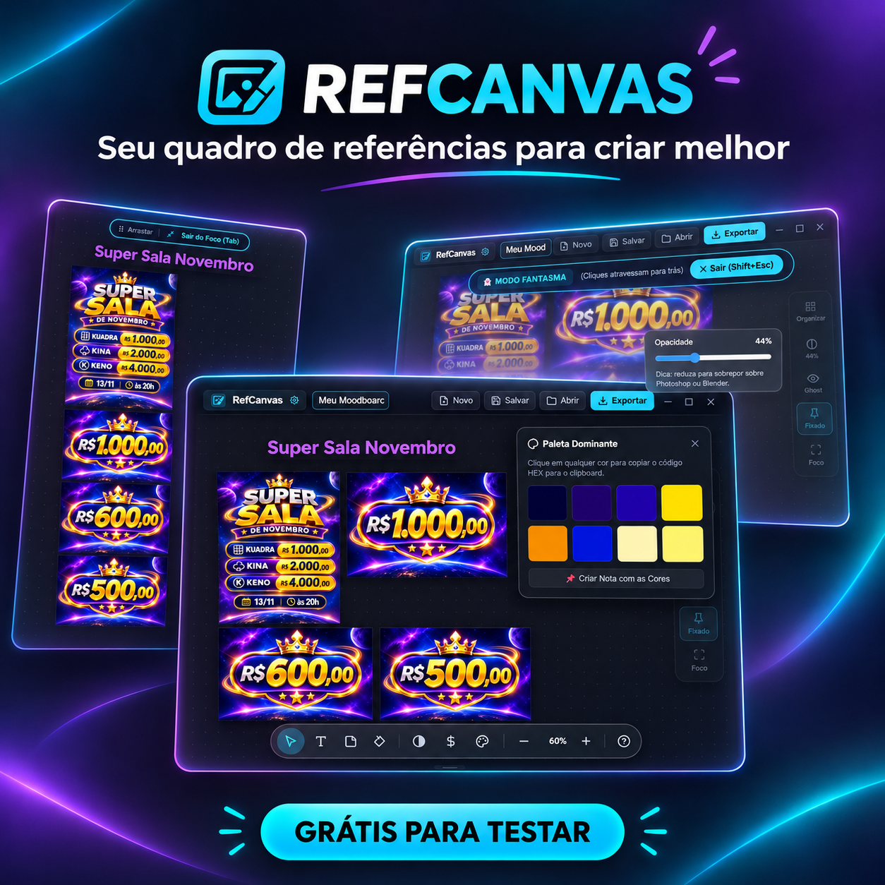
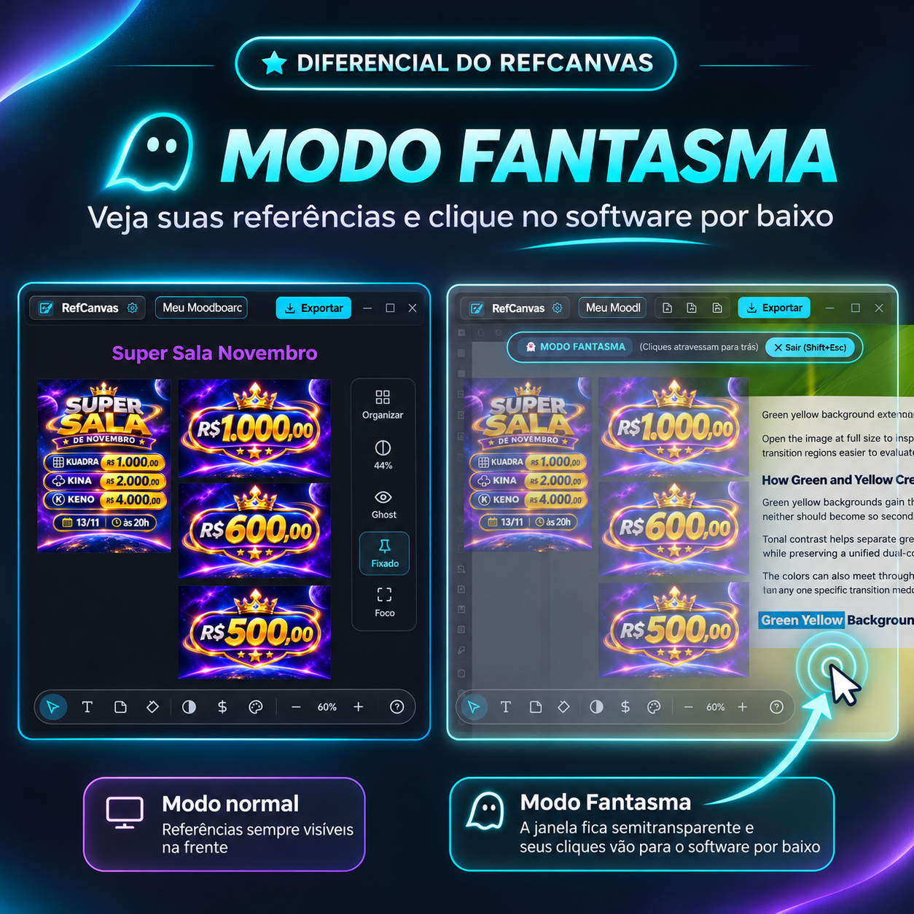
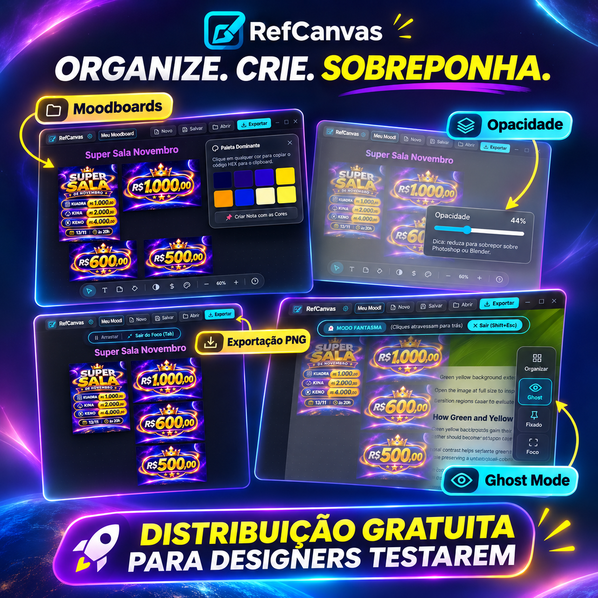

# RefCanvas
### *O Canvas de Referências Infinito, Leve e Moderno para Artistas e Criadores*

**Uma alternativa moderna, rápida e gratuita ao PureRef para Windows.**

 

  

---

> [!IMPORTANT]
> **Gostou do RefCanvas?** Se este software acelerou o seu fluxo criativo, clique no botão **⭐ Star** no topo direito desta página. É a melhor forma de apoiar o projeto e ajudar outros artistas a descobrirem uma alternativa moderna e gratuita!

---

## 🎨 Sobre o RefCanvas

O **RefCanvas** foi desenvolvido sob medida para ilustradores, artistas 3D, concept artists, designers e modeladores que precisam organizar referências visuais sem travar o computador. 

Diferente de alternativas pesadas ou pagas, o RefCanvas é construído com arquitetura nativa em **C# / WebView2**, oferecendo performance ultrafluida, consumo mínimo de memória RAM e inicialização instantânea.

---

## ✨ Recursos Principais

### 👻 Modo Fantasma (*Click-Through Overlay*)
Trabalhe no **Blender, Photoshop, ZBrush, Maya ou Figma** com suas referências flutuando sobre a sua viewport. No Modo Fantasma, seus cliques passam através do RefCanvas diretamente para o seu software de criação!
- Atalho global: `Ctrl + Shift + G`
- Saia do modo a qualquer instante com `Esc`

  

---

### 📦 Organização Automática Inteligente (*Smart Auto-Pack*)
Chega de organizar referências manualmente. Pressione `Ctrl + P` e o algoritmo de empacotamento inteligente organiza automaticamente todas as suas fotos em um grid compacto e harmonioso.

### 🎯 Modo Foco Imersivo (*Zen Mode*)
Esconda qualquer distração da interface com uma única tecla (`Tab`). Apenas a sua arte e suas referências em tela.

### 💧 Paleta de Cores & Conta-Gotas Preciso
- Use a ferramenta Conta-gotas (`I`) com lupa de zoom pixel-perfect.
- Copie códigos HEX ou RGB automaticamente para a área de transferência.
- Extraia automaticamente as cores dominantes das suas imagens para moodboards de cor.

### 📝 Anotações & Sticky Notes
Adicione caixas de texto (`T`) e notas adesivas coloridas (`N`) diretamente no canvas para anotar feedbacks, briefings ou valores de iluminação.

### ⚡ Outras Vantagens:
- **Canvas Infinito**: Zoom suave e navegação panorâmica sem limites.
- **Sempre no Topo**: Mantenha suas referências visíveis sobre qualquer aplicativo.
- **Salvar & Exportar**: Salve seus projetos em formato nativo `.refboard` ou exporte o moodboard montado em imagem de altíssima definição (PNG).
- **Sem Telemetria Invasiva**: Suas imagens ficam 100% salvas na sua máquina local.

  

---

## ⌨️ Atalhos de Teclado & Controles

| Ação | Atalho / Controle |
| :--- | :--- |
| **Arrastar Imagens / Arquivos** | Arraste diretamente de pastas ou do navegador |
| **Colar Imagem da Área de Transferência** | `Ctrl + V` |
| **Mover / Panorâmica do Canvas** | Segure `Botão Direito` ou `Espaço + Botão Esquerdo` |
| **Zoom in / out** | Rolar a `Roda do Mouse` |
| **Modo Fantasma (Click-Through)** | `Ctrl + Shift + G` (ou `Esc` para sair) |
| **Modo Foco (Ocultar Interface)** | `Tab` |
| **Auto-Organizar Imagens (Pack)** | `Ctrl + P` |
| **Enquadrar Tudo na Tela** | `F` ou `Ctrl + 0` |
| **Duplicar Seleção** | `Ctrl + D` |
| **Conta-Gotas / Copiar Cor** | Tecla `I` |
| **Adicionar Texto** | Tecla `T` |
| **Adicionar Nota Adesiva** | Tecla `N` |
| **Tons de Cinza (Grayscale)** | `Alt + G` |
| **Inverter Cores** | `Alt + I` |
| **Espelhar Horizontal / Vertical** | `Alt + H` / `Alt + V` |
| **Salvar Projeto** | `Ctrl + S` |
| **Novo Projeto** | `Ctrl + N` |

---

## 📥 Como Instalar

1. Acesse a página de **[Releases](https://github.com/vnadoti/RefCanvas/releases/latest)**.
2. Baixe o instalador mais recente: `RefCanvas Setup.exe`.
3. Execute o instalador e conclua a instalação em poucos segundos.
4. Abra o **RefCanvas** pelo menu Iniciar ou atalho na Área de Trabalho!

### 💻 Requisitos do Sistema
- **Sistema Operacional:** Windows 10 (64-bit) ou Windows 11
- **Memória RAM:** 512 MB ou superior
- **Espaço em Disco:** ~150 MB

---

## ❓ Perguntas Frequentes (FAQ)

<b>1. O RefCanvas é gratuito?</b>

Sim! O RefCanvas é 100% gratuito (Freeware) para uso pessoal e comercial.

<b>2. O código-fonte está disponível?</b>

Não. O RefCanvas é distribuído como software proprietário gratuito fechado. O repositório no GitHub serve para distribuição dos instaladores oficiais, changelog, sugestões de novos recursos e reporte de problemas.

<b>3. O RefCanvas envia meus arquivos para a nuvem?</b>

Não. Suas imagens, anotações e boards ficam armazenados exclusivamente no seu disco rígido local.

<b>4. Como sugerir um recurso ou reportar um bug?</b>

Você pode abrir uma <a href="https://github.com/vnadoti/RefCanvas/issues">Issue no GitHub</a> usando nossos formulários oficiais.

---

## 💬 Comunidade & Suporte

- 🐛 **Encontrou um bug?** [Abra uma Issue](https://github.com/vnadoti/RefCanvas/issues/new?template=bug_report.yml)
- 💡 **Tem uma sugestão?** [Envie sua ideia](https://github.com/vnadoti/RefCanvas/issues/new?template=feature_request.yml)

---

## 📜 Licença

Distribuído sob licença Freeware Proprietária. Consulte o arquivo [LICENSE](LICENSE) para mais informações sobre os termos de uso.

   
  <b>Se o RefCanvas é útil para você, considere deixar uma estrela ⭐ no topo da página!</b>
    

